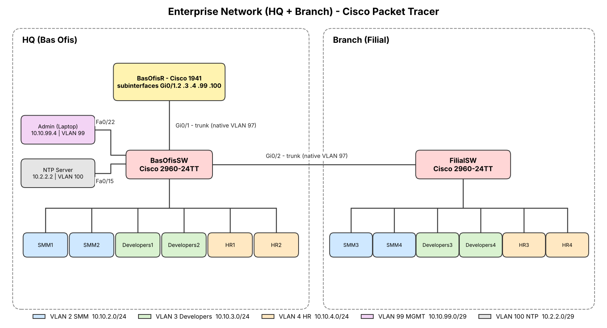

# Enterprise Network (HQ + Branch) in Cisco Packet Tracer

A two-site enterprise network designed and configured in **Cisco Packet Tracer 8.2.2**. The HQ and the branch office are segmented into VLANs by department. A single router provides inter-VLAN routing and DHCP, and the switches are hardened with common Layer 2 security features.

## Devices

| Device | Model | Role |
|---|---|---|
| BasOfisR | Cisco 1941 | Router-on-a-stick, DHCP server, NTP client |
| BasOfisSW | Cisco 2960-24TT | HQ access switch, VTP server |
| FilialSW | Cisco 2960-24TT | Branch access switch, VTP client |
| 12 x PC | PC-PT | 6 at HQ, 6 at the branch (SMM, Developers, HR) |
| Admin | Laptop-PT | Management workstation (VLAN 99) |
| NTP Server | Server-PT | Time source for all network devices (VLAN 100) |

## VLANs and addressing

| VLAN | Name | Subnet | Gateway (router subinterface) |
|---|---|---|---|
| 2 | SMM | 10.10.2.0/24 | 10.10.2.254 (Gi0/1.2) |
| 3 | Developers | 10.10.3.0/24 | 10.10.3.254 (Gi0/1.3) |
| 4 | HR | 10.10.4.0/24 | 10.10.4.254 (Gi0/1.4) |
| 99 | MGMT | 10.10.99.0/29 | 10.10.99.6 (Gi0/1.99) |
| 100 | NTP | 10.2.2.0/29 | 10.2.2.1 (Gi0/1.100) |
| 97 | (native VLAN on trunks) | - | - |

Management addresses: BasOfisSW 10.10.99.3, FilialSW 10.10.99.2, Admin laptop 10.10.99.4, NTP server 10.2.2.2.

## What is configured

**Switching**
- 802.1Q trunks between the router and BasOfisSW (Gi0/1) and between the two switches (Gi0/2)
- DTP disabled on trunks (`switchport nonegotiate`) and a dedicated native VLAN (97)
- VTP version 2: BasOfisSW is the server and FilialSW is the client (domain and password set)
- PVST spanning tree, PortFast and BPDU Guard on access ports

**Routing and services**
- Inter-VLAN routing with router-on-a-stick (dot1Q subinterfaces)
- DHCP pools for the SMM, Developers and HR VLANs, with excluded address ranges for static devices
- NTP synchronization to 10.2.2.2 on the router and both switches

**Security hardening**
- SSH version 2 only on the VTY lines, with a standard ACL that allows only the management subnet (10.10.99.0/29)
- Local user accounts, `enable secret` and `service password-encryption`; login banners
- Port security with sticky MAC addresses on access ports
- DHCP snooping (trusted on the trunk ports) with a rate limit on access ports
- Dynamic ARP Inspection
- Unused ports administratively shut down

## Repository contents

| Path | Description |
|---|---|
| `Sebeke-Final.pkt` | The Packet Tracer project file (open with Packet Tracer 8.2.2 or newer) |
| `topology.png` | Network topology diagram |
| `BasOfisR-config.txt`, `BasOfisSW-config.txt`, `FilialSW-config.txt` | Running configurations of the router and both switches (password hashes removed) |

## Author

Elvin Ahmadov - IT Specialist / Network Administrator  
[LinkedIn](https://www.linkedin.com/in/elvinahmadov-networkadmin/)
